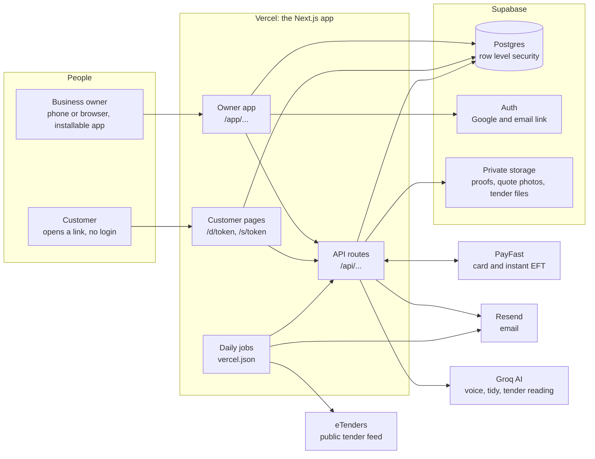
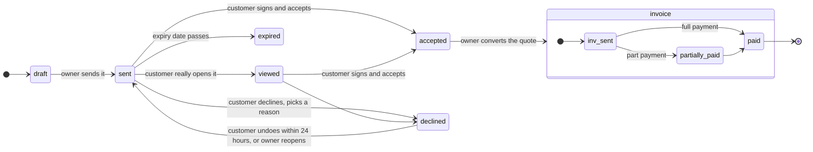
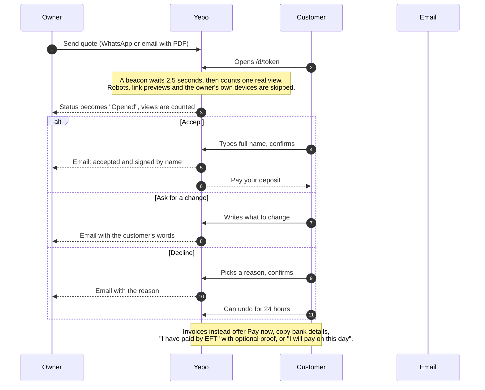
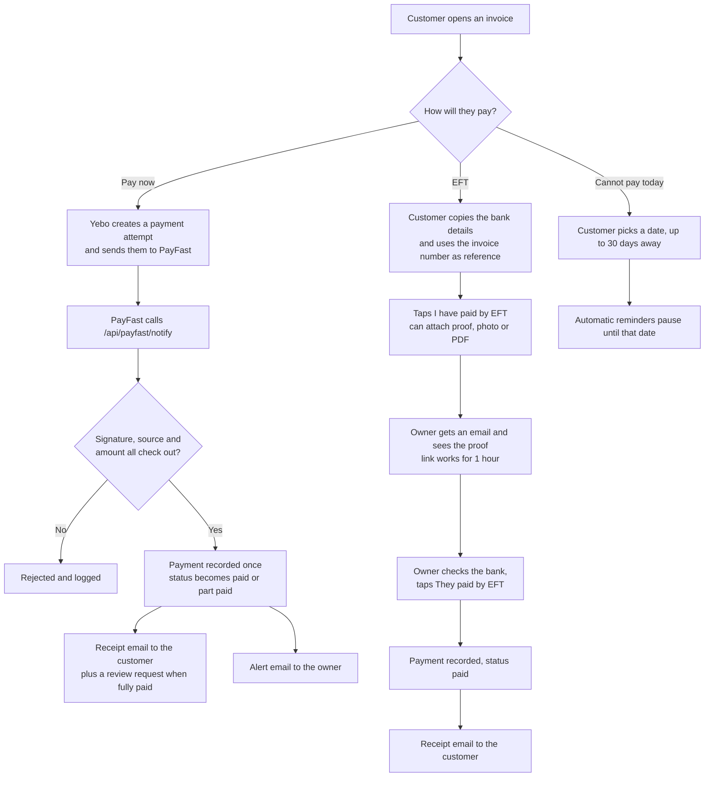
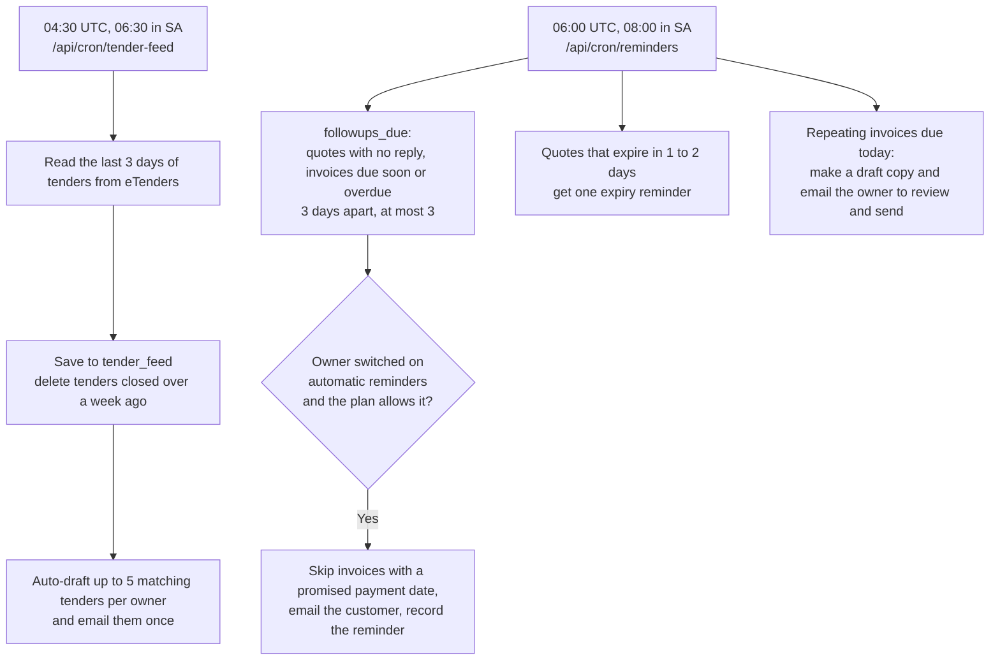
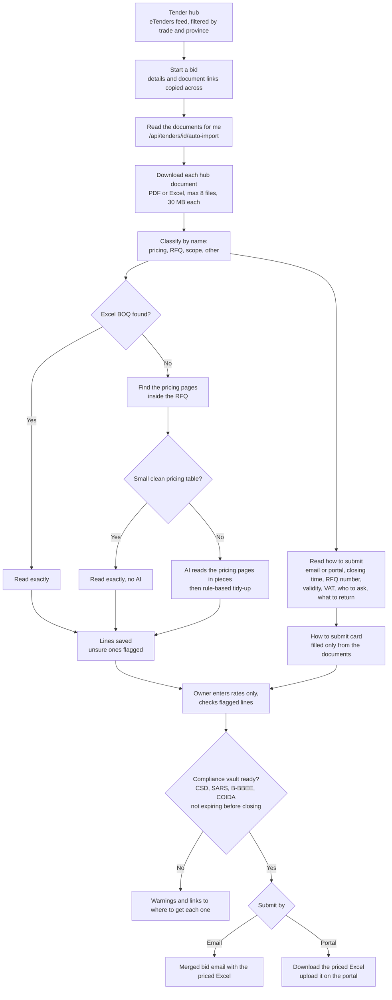
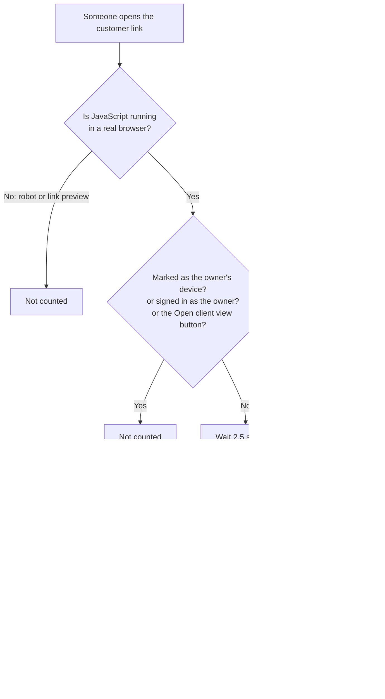
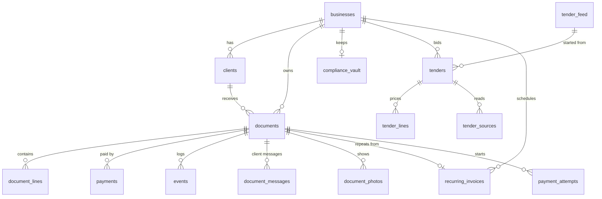

# How Yebo Invoices works

These diagrams are written in Mermaid, so GitHub draws them for you. If you read this file somewhere that shows plain text, paste a diagram into [mermaid.live](https://mermaid.live) to see it.

Back to the [README](../README.md). The database setup, environment variables and feature list live there.

## 1. The big picture

The owner app uses the signed-in user, so row level security keeps each business's data private. Customer pages never log in: they use a long random token in the link and call security-definer database functions that return only what that one document needs. The service-role key is used on the server only (`src/lib/supabase/admin.ts`), for jobs and webhooks that have no signed-in user.

## 2. The life of a quote and an invoice

A quote that is accepted can take a deposit first (online or EFT). When it becomes an invoice the deposit is credited, so the customer only pays the balance. Sent documents are locked. To correct one, duplicate it, fix the copy and send that.

## 3. What the customer can do on the link

## 4. How money moves

Yebo never holds money. PayFast pays out to the business's own PayFast account, and EFT goes straight to the business's bank.

## 5. What runs every day

The recurring-invoice job runs inside the reminders job, so it does not use an extra Vercel cron slot. It can also be triggered by hand at `/api/cron/recurring` with the `Authorization: Bearer <CRON_SECRET>` header.

## 6. The Tender Engine

Rules, not training: the reader in `src/lib/tender-docs.ts` is plain code tested against real tender PDFs. It only fills in what is literally written in the documents. The AI is a fallback for large or unusual pricing tables, and every AI-read line is flagged for the owner to check.

## 7. Who counts as a "customer view"

An owner who opens the link in a private window or on someone else's phone is still counted as a customer, because Yebo cannot tell the difference there.

## 8. Data model

`document_messages` holds the customer's change requests, proofs of payment, payment promises and typed signatures. Each business also has `subscriptions`, `monthly_targets`, `payfast_settings` and `tender_preferences`. The full list is in the migrations table below.

## 9. Where the private files live

| Storage bucket | What is in it | Who can open it |
|---|---|---|
| `logos` | Business logos and work photos | Public (shown on customer pages) |
| `payment-proofs` | Proof of payment from customers | Owner only, through a link that lasts 1 hour |
| `quote-photos` | Photos the owner attaches to a quote | Customer pages and the owner, through links that last 1 hour |
| `tender-files` | Tender documents and compliance files | The owner who uploaded them |

## 10. Security in one place

| Rule | How it is kept |
|---|---|
| One business can never see another's data | Row level security on every table, using `owns_business()` |
| Customers need no account | A long random token per document (`/d/token`) and per client (`/s/token`), read through security-definer functions |
| Uploads are checked | The real file type is read from the first bytes. Size and count limits apply |
| Robots cannot fake views or claims | Views come from a browser beacon, claims and promises are rate limited in the database |
| Free text from strangers stays out of email | Decline reasons are a fixed list. Change requests are length limited and escaped |
| Daily jobs are private | They need `Authorization: Bearer <CRON_SECRET>` |
| Money never passes through Yebo | PayFast pays the business directly. EFT goes to the business's bank |
