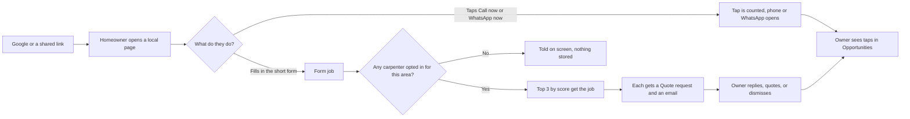
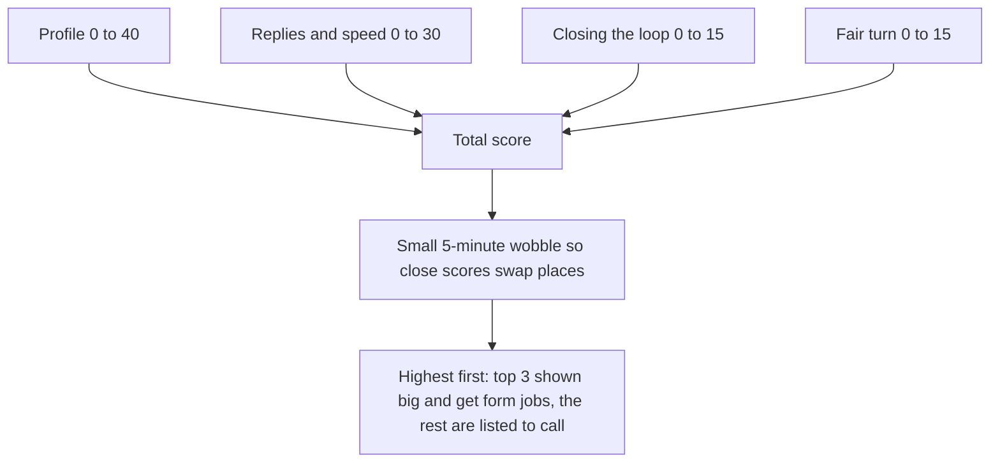

# Yebo Opportunities: how it works today

This is the built version (v0 to v1.3), in plain English. The research and plan are in [OPPORTUNITIES.md](./OPPORTUNITIES.md). Where the two disagree, this file describes what the code does.

**One line:** public local pages on yeboinvoices.com let a homeowner call a carpenter, or send one request to up to three carpenters. It is not pay per lead. Carpenters opt in, and the order they appear in is a published score.

## 1. The big picture

## 2. The pages

- `/jobs` is the hub. It shows each page with a photo and how many carpenters are ready for that area.
- `/jobs/<slug>` is one trade in one area. Today: door repairs and cupboard repairs in Johannesburg, carpenter in Midrand, Kempton Park, Edenvale, Sandton and Randburg, and emergency carpenter in Pretoria.
- Each page shows, top to bottom: a photo hero with the problem and the answer, the top carpenters with Call now and WhatsApp now, the short form, why Yebo is different, full carpenter profiles (badges, work photos, reviews they supplied, Google reviews link), more carpenters in the area, real work photos, what people ask for, a price guide (only when real prices are filled in), why we open area by area, how it works, questions, and how we choose.
- Pages refresh about every 5 minutes. They carry page, FAQ, photo and professional markup for Google, and breadcrumbs. They are in the sitemap and linked from the footer.
- The "still being rolled out" message is part of the page text on purpose.

## 3. Two ways to reach a carpenter

**Route A: the form.** A homeowner taps what they need, then adds name, WhatsApp and suburb. Photos, email, date and details are optional. The request goes to the top three carpenters for that page's area, as a normal Quote request tagged `yebo-<page>`. Each owner gets an email, and Make a quote, WhatsApp, Email, Propose a visit and Dismiss all work as they do for a request from their own link.

**Route B: direct.** Call now and WhatsApp now are normal links. The WhatsApp message is pre-filled: "Hi {name}, I found you on Yebo (yeboinvoices.com). I need help with {the job on that page}. Can you quote me?" Each tap is counted for that carpenter and that page.

## 4. The score (who is on top)

Every opted-in carpenter gets a score out of 100.

| Part | Points | How it is earned |
| --- | --- | --- |
| Profile | up to 40 | Logo 8, phone 8, a line about the business 8, at least 3 work photos 8, year started 4, reviews (a Google link or at least one review) 4 |
| Replies and speed | up to 30 | Over the last 30 days of local jobs: up to 18 for the share the owner **responded to** (tapped Make a quote, or proposed a site visit; dismissing does not count), plus up to 12 for speed (within 1 hour full marks, then 75% within 4 hours, 50% within 24 hours, 25% after). Fewer than 3 jobs: a neutral 15 |
| Closing the loop | up to 15 | The share of jobs where the owner answered "Did you get this job?" (yes or no). Winning does not matter, answering does. Fewer than 3 jobs: a neutral 7 |
| Fair turn | up to 15 | About 1 point per 8 hours since the carpenter was last given a form job, capped at 15 after 5 days. Never given a job: 15 |

**Worked example.** Granite, with a full profile and no jobs yet: 40 + 15 + 7 + 15 = 77. A carpenter with only a logo, phone and about line, also new: 24 + 15 + 7 + 15 = 61. After Granite is given a job its turn points drop to 0 and climb back over about 5 days.

**The wobble.** A small offset of between minus 3 and plus 3, which changes every 5 minutes and is different for each carpenter, is added when sorting. Carpenters with close scores take turns at the top. The same sorted list decides who is shown and who gets form jobs.

**What the score cannot be bought with.** Nothing. There is no paid top spot, and carpenters do not pay per lead.

## 5. What a carpenter sees and does

1. Signs in to Yebo and opens **Opportunities** (the What's new card links there).
2. Ticks the trade and areas, and switches it on. From then on their name, logo, phone, about line, work photos, badges and reviews can appear on the matching pages.
3. Sees, for the last 30 days: jobs sent to them, jobs they won, taps on Call now, taps on WhatsApp now, their profile score and what to add to raise it.
4. Gets "Did you get these jobs?" prompts one day after a job arrives, with Yes and No buttons.
5. Replies to jobs in **Quote requests**, as always.

## 6. Data (what is stored)

| Where | What |
| --- | --- |
| `businesses` | `opp_enabled`, `opp_trades`, `opp_areas`, `opp_last_at` (when they were last given a form job) |
| `quote_requests` | The job itself, with `source = yebo-<page>`; `responded_at` (stamped by a database trigger the first time the owner starts a quote or proposes a visit); `outcome` (`won` or `lost`) and `outcome_at` |
| `opportunity_jobs` | One row per form job sent: page, trade, area, how many carpenters got it. No personal details. Also used for the hourly cap of 40 form jobs |
| `opportunity_clicks` | One row per Call now or WhatsApp now tap: business, page, kind. Owners can read their own |

Migrations: 0038 (opt-in and jobs), 0039 (taps), 0040 (response time and outcomes).

## 7. Guards

- A hidden trap field catches bots.
- A form job needs a WhatsApp number or an email, and valid text.
- One carpenter receives at most 15 requests an hour. All of Yebo's local pages together take at most 40 form jobs an hour.
- The same person sending the same words twice within 10 minutes counts once per carpenter.
- Photos are checked by their real bytes, at most 3, and shrunk in the browser.
- Tap counting only accepts a real, opted-in business and a real page.

## 8. Rolling out area by area

We open one trade and one area at a time so that each request has someone ready. Until a carpenter opts in for an area, its page says so and a form request there stores nothing. The hub shows, per area, how many carpenters are ready.

## 9. Honest limits

- **Details are not hidden.** A form job goes straight to the top three. Hiding contact details until a carpenter accepts is planned, not built.
- **Taps are not outcomes.** We count a tap, not whether the call connected or the job was won.
- **Self-reported.** Profile content, reviews and "Did you get this job?" are entered by the business. We label reviews as supplied by the business and add no rating markup.
- **Responded means started.** "Make a quote" can be tapped without sending the quote. We do not yet check that a quote went out.
- **Three carpenters, one job.** With three quoting, two lose each job. That is fair, but jobs need to be frequent enough to stay worth it.
- **Prices are empty on purpose.** The price section appears only when technician-confirmed prices are added to `PRICES` in `src/lib/opportunities.ts`.
- **No plan limits yet.** The Opportunities subscription (the R950 idea) is not built.

## 10. How to extend it

- **A new page or area:** add to `AREAS` and `PAGES` in `src/lib/opportunities.ts`. The sitemap, hub and form pick it up.
- **A new trade:** add to `TRADES`, set `trade` on the page, and let businesses tick it in `/app/opportunities`.
- **A photo:** put a resized jpg in `public/jobs/` and add an entry with alt text and a caption to `PHOTOS`. Describe only what the photo shows. Do not use photos where a person's face is visible without permission.
- **Prices:** fill `PRICES` with numbers a technician has confirmed.
- **The score:** `src/lib/opp-rank.ts`. Change it in the open, and update the "How we choose" text on the pages and this file.

## 11. Measuring the test

- Search Console: impressions and clicks for `/jobs` pages.
- Quote requests and Requests page: the "Where requests came from" chart, tagged `Yebo Opportunities: <page>`.
- `/app/opportunities`: jobs, wins, call taps and WhatsApp taps.
- Decide with real numbers: after 4 weeks, are pages being found, are visitors sending jobs or tapping, and are carpenters replying and winning?
