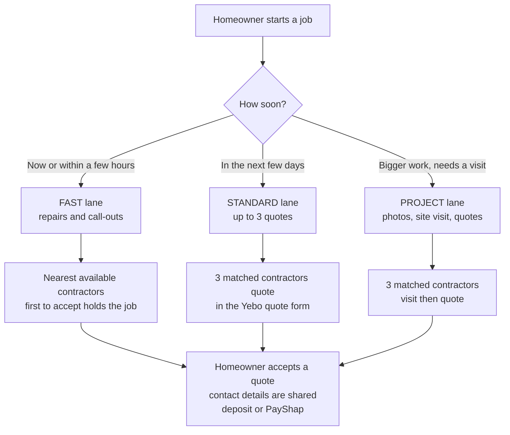
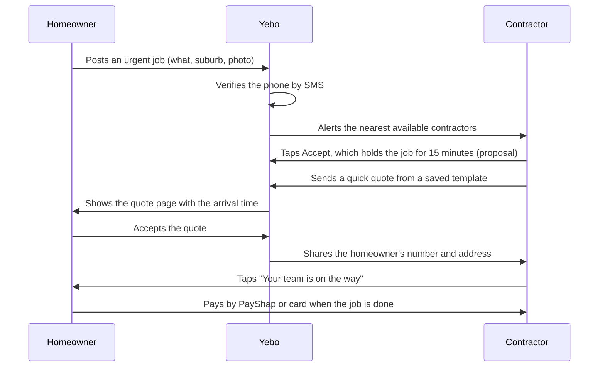
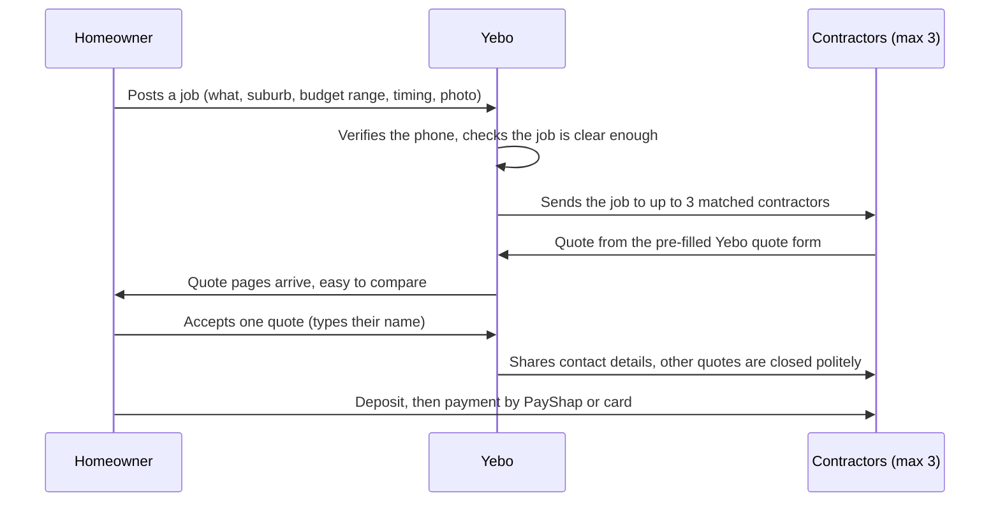
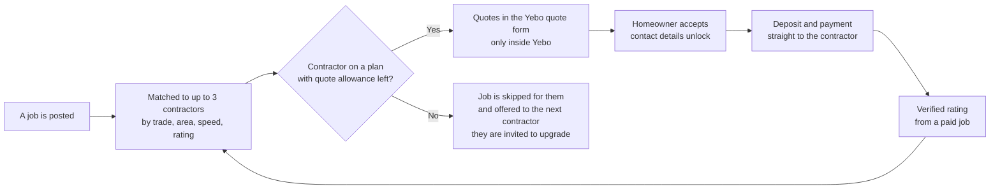
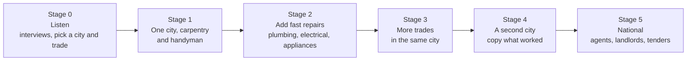
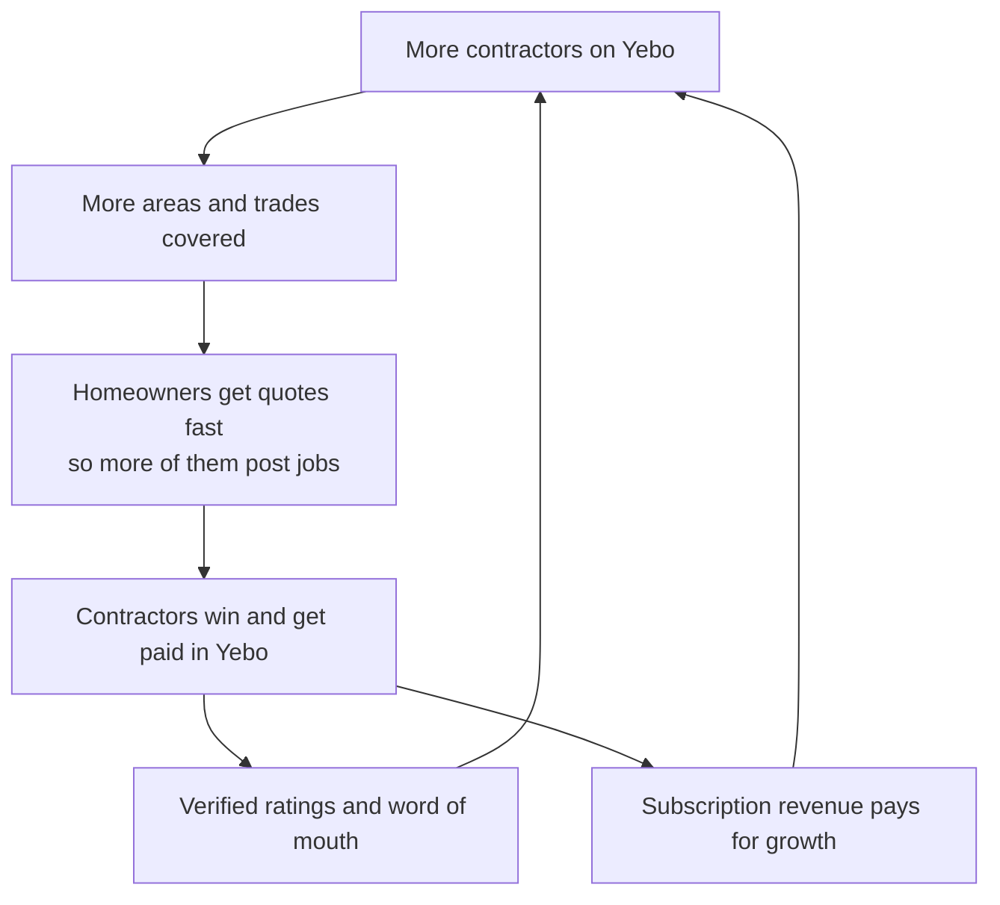

# Yebo Opportunities: research, plan and how we scale it

Status: **plan, nothing built yet.** Last updated 3 November 2026. Numbers marked *(proposal)* are our own starting guesses to test, not research.

Opportunities lets a homeowner post a job and get a few real quotes from Yebo contractors. It exists for one reason: **more contractors using Yebo.** A contractor who finds a job in Yebo, quotes it in Yebo and gets paid through Yebo has no reason to leave.

## 1. Problem statement

- **Contractors** on lead sites pay before they win anything, share each lead with many rivals, and get no refund for dead leads. Good small businesses stop trusting paid leads.
- **Homeowners** who post a job get a flood of calls from strangers and quotes that are hard to compare. Many give up and ask a neighbour.
- **Yebo already has the hard part:** a clear quote page, an accept button with a typed name, deposits, PayShap and card payment, reminders, a win-rate report. We only need the front door: a job, posted well, reaching the right few contractors.

Goal in one line: *a homeowner posts a job once and gets two or three real, comparable quotes within a day, from verified contractors who are not drowning in competition.*

## 2. How we are different (and the rules we keep)

**We are not selling leads.** Contractors pay a **monthly subscription** for Yebo. Opportunities is one of the things the subscription unlocks. There is no fee per lead, no fee per job and no commission.

**Contractors can quote an Opportunity only inside Yebo.** The job is sent to them, they open the Yebo quote form (pre-filled), and the homeowner sees the Yebo quote page. The homeowner's phone number and exact address stay hidden until the homeowner accepts a quote. Because we take no commission, a contractor has nothing to gain by dodging the platform, and everything to gain from the deposit, PayShap and reminders built into it.

| Lead sites do this | Yebo Opportunities does this |
| --- | --- |
| Sell the same lead to 5 or 10 businesses | Send a job to at most 3, so every quote has a real chance |
| Charge per lead, before the job is won | Included in the subscription. Never per lead |
| Contractor re-types everything into a quote | The job opens in the Yebo quote form, pre-filled |
| Homeowner gets calls from strangers | Homeowner sees clean quote pages. Phone stays private until they accept |
| Reviews that can be unverified | Ratings only from jobs that went quote, accept, pay inside Yebo |
| Contractor chases payment alone | Deposit, PayShap, card and reminders are built in |

Principles:

1. **No pay-to-play.** Nobody buys their way to the front. Matching is trade, area, response speed and rating. A higher plan gives a bigger quote allowance, never a better position.
2. **Few, not many.** Three quotes is what homeowners want. More is noise.
3. **We never hold the money.** The homeowner pays the contractor directly.
4. **The homeowner feels safe first.** No spam, no leaked address, no pressure.
5. **Honest about gaps.** If we have no contractor for that trade and suburb, we say so. We do not post a job into the void.

## 3. What exists today

| Platform | How it makes money | What people say |
| --- | --- | --- |
| [Snupit](https://www.itweb.co.za/article/snupit-joins-proudly-south-african-powering-local-growth-through-technology/dgp45qaByoovX9l8) | Reported as pay per lead (a rival's claim, not confirmed by Snupit) | Scale: founded 2012 in Pietermaritzburg, 500,000+ business registrations, 600+ categories (IT-Web, 25 June 2025). Rivals say lead quality varies and credentials are not independently verified |
| [Bark](https://www.bark.com/en/za/sellers/pricing/) | Credits to respond to each lead, valid 3 months, no commission, refund only on the first pack | [Hello Peter](https://www.hellopeter.com/barkcom) rating 1.3, 91.7% one-star in the last 12 months. Themes: dead or invalid leads, credit and refund disputes, paying before knowing the job is real. A rival blog says each lead goes to about 5 contractors ([Hook Agency](https://hookagency.com/blog/bark-reviews-contractors/)) |
| Kandua | Commission or matching fee (per a rival, no amounts given) | One matched pro per job, so contractors have little control |
| [Plan a Job](https://planajob.com/za/pricing) | A **monthly licence** for contractors who join a waitlist and pay an entry fee. Amounts are not on its pricing page | The closest model to ours: a contractor operating system (jobs, quotes, invoices, dispatch) with a marketplace included on paid accounts. Customers invited by a contractor join free. A homeowner who just wants work done has their details passed to a nearby contractor |
| [Near a Builder](https://itweb.africa/article/south-african-startup-near-a-builder-gains-traction/kYbe97XxBGe7AWpG) (2013) | Contractors pay as they go | Notified 10 tradesmen within 20 km and forwarded the first 5 quotes. Its founders said their biggest problem was getting the brand known |

Lessons: (a) the pain is on the contractor side, paying before winning; (b) Plan a Job shows subscription plus marketplace is already a model in South Africa, so we should be clearer and cheaper at the start; (c) matching was never the hard part, **distribution** was. That is why our installed base of contractors matters more than clever matching.

Most complaint evidence comes from review sites and rivals. Before launch we interview 10 contractors who used Snupit or Bark (see the plan).

## 4. Three lanes: fast repairs, standard jobs, projects

Not every job is the same. A burst geyser cannot wait three days for three quotes. A deck renovation should not be rushed. So a job goes into one of three lanes.

| | Fast lane | Standard lane | Project lane |
| --- | --- | --- | --- |
| Examples | Burst pipe, dead geyser, broken lock, gate motor, appliance repair, electrical fault | Fix a door, build a shelf, paint a room, tile a bathroom floor | Kitchen, deck, extension, full paint job |
| Answer wanted | Minutes | Within 24 hours | Within 2 to 3 days |
| Contractors invited | Up to 3 nearest who are available now, widening to the next 3 after 10 minutes *(proposal)* | 3 matched | 3 matched |
| What the quote is | A call-out fee plus a rate or a fixed price, from a saved template | A normal Yebo quote | A normal Yebo quote after a visit |
| Closes if no quote | After 30 minutes, with an honest message | After 48 hours | After 5 days *(proposal)* |
| Extra safety | Only contractors who set themselves "available now" and have a verified phone plus at least one completed job or a reference | Standard checks | Standard checks, optional photos and site visit |

### Fast lane, step by step

Speed is the feature here. Homeowners in a hurry choose on who calls first and on price, so the lane is built to reply in minutes.

Why this fits Yebo: the "Your team is on the way" button and the client banner already exist, PayShap means a repair is paid in minutes even on a weekend, and the quote form already holds saved items, so a call-out template is small work.

New pieces for the fast lane: an "Available now" switch with the areas covered, a WhatsApp or push alert, the 15-minute hold, a call-out template, and a clear price shown up front (including any after-hours charge) so urgent jobs cannot turn into surprise bills.

### Standard lane, step by step

## 5. How the subscription works

Opportunities is part of the plans we already have. We never charge for a lead.

Proposed gating, to test in the contractor interviews *(proposal, not decided)*:

| Plan (price today) | Opportunities allowance | Fast lane | Notes |
| --- | --- | --- | --- |
| Side-Hustler (R49) | A few job quotes a month, enough to taste it | No | Quote allowance, not a lead count |
| Real Business (R199) | A generous monthly allowance | Yes | The plan most small contractors should land on |
| Industry King (R499) | Unlimited | Yes | Extra trades and areas, team members, estate agent and landlord accounts. **Not** better matching |
| Trial | 3 job quotes | No | So a new contractor feels it before paying |

Rules that keep it honest:

- An allowance counts **quotes sent**, never leads received. Seeing a job is free.
- A job that is closed, cancelled or never answered by the homeowner does not use up an allowance.
- Allowances reset every month. We never sell a bundle of leads.
- Everything a contractor already pays for (quotes, invoices, reminders, PayShap) keeps working the same.

Illustration only, not a forecast: 100 paying contractors on Real Business at R199 is R19,900 a month. Each extra contractor who joins because of Opportunities adds to that, and brings their own clients with them.

## 6. Where good jobs come from

In a [Procompare survey](https://www.procompare.co.za/articles/for-customers/survey-client-challenges) (Oct to Nov 2022, 461 South African professionals and 385 clients, run by a lead platform so it has a bias), about 63% of clients search Google for a pro, about 1 in 5 asks friends and family, and fewer than 10% use social media. Most collect 2 or 3 quotes, and clients choose mostly on price (31%) and on who calls first (26%). 74% of pros say word of mouth brings most of their clients, and 48% say their biggest problem is not having enough clients.

| Source | Why it is good | How we do it | Speed and cost |
| --- | --- | --- | --- |
| 1. Contractors passing jobs on | A busy carpenter turns work away every week | A "Pass this job on" button sends it into Opportunities. Homeowner is served, contractor earns goodwill | Fast, free. Brings supply and demand together |
| 2. Contractors' past clients | Warm, trusted, already paid, and they need other trades | After a paid job the thank-you message adds "Need another job done? Post it here". Trades refer across (carpenter to plumber to painter) | Fast, free |
| 3. Google search pages | Highest-intent demand | One page per trade and suburb with a post-a-job form and real local content. Start early, it is slow | 3 to 6 months, cheap |
| 4. Estate agents, landlords, body corporates | Repeat small repairs, steady volume, reliable payers | A simple account: post jobs, get 3 quotes, approve | Medium, free |
| 5. QR codes on vans, quotes, invoices | Every Yebo user is a billboard | "Need a job done?" link on the client page footer. The request link and QR already exist | Fast, free |
| 6. Neighbourhood Facebook and WhatsApp groups | Suburb groups are full of "anyone know a good ...?" | Helpful posts by the founder, measured as a test | Fast, free, lower share of clients |
| 7. Hardware and building suppliers | Homeowners standing in the aisle with a problem | Counter card with a QR code, agreed with a local store | Medium, low cost |
| 8. Paid ads | Scales once the funnel works | Only after 1 to 3 prove it. Small capped test first | Costs money |
| 9. Tenders and RFQs | Bigger jobs. We already have a Tenders page | Separate lane for now. Requirements differ by municipality | Slow |

Order of attack: 1, 2 and 5 first (free, built on people already in Yebo), then 3 (start now, it is slow), then 4, 6 and 7. Hold 8 and 9.

For fast repairs, add: Google "plumber near me" style pages (3), estate agents and landlords who need repairs fast (4), and a sticker or fridge magnet with a QR code that homeowners keep (5, 7).

## 7. Quality: how we keep it clean

| Who | The check | Why |
| --- | --- | --- |
| Homeowner | Cellphone verified by SMS before posting. One active job per number (small jobs excepted) | Stops fake and duplicate jobs |
| The job | Must say what, suburb, budget range, timing and have a photo if it is bigger than a small job. Vague jobs get one friendly question back | Contractors only see jobs they can price |
| The job | Sent to at most 3 matched contractors. Closes when one is accepted or the lane's time runs out | No race to the bottom, no stale leads |
| Contractor | Verified phone, complete profile (trade, areas, photo of past work). Optional badges: company registration, insurance, references | Homeowners see why to trust them |
| Contractor | Rating only from jobs completed through Yebo. Replying within 24 hours (30 minutes in the fast lane) keeps them in the matching pool | Reviews cannot be bought, and ghosting is punished |
| Both | Contact details private until acceptance. A report button on every job and quote | Protects both sides. POPIA, the South African privacy law, is respected from the start |
| Money | Payment straight to the contractor. We hold no funds | No escrow, no payment referee |

Matching rule in plain words: rank by trade match, area, how fast they usually answer, and rating. Rotate fairly so the same three do not get everything. New contractors get a small boost so they can earn a first rating.

## 8. How we scale it

The rule: **dense before wide.** A trade in a suburb cluster must work well before we add the next one. A job that finds nobody is worse than no job feature at all.

Each stage opens only when the one before has met its gate *(all numbers are proposals)*:

| Stage | We open it when | Gate to move on |
| --- | --- | --- |
| 0. Listen | We have the interview answers | 7 of 10 contractors say they would quote on a free job |
| 1. One city, one trade | Settings for trade and area, post a job, SMS check, jobs card, quote this job, cap of 3, pass this job on | 20 jobs posted, 70% get a quote within 24 hours |
| 2. Fast repairs | The fast lane (availability switch, alerts, 15-minute hold, call-out template) | 60% of fast jobs get a quote within 30 minutes, with at least 5 available contractors per trade |
| 3. More trades | A contractor of that trade is on board and active | 100 jobs posted, 40% accepted |
| 4. Second city | Stages 1 to 3 hold in city one, and we know the cost to win a contractor | Same gates in the new city, with cost per contractor below what they pay in a year |
| 5. National | Gates met in two cities | Subscription revenue covers the cost of running Opportunities |

Open a trade in an area only when there are **at least 5 verified, active contractors** *(proposal)*. If a suburb drops below 2, we pause posting there and say so honestly.

### The growth loop

What makes it Yebo's loop and not another lead site: every contractor who joins for Opportunities also gets the quoting, invoicing and payment tools, so they stay for the tools even in a quiet month.

## 9. What we build, and what we reuse

Reuse:

- the public request page and link (`/r/<token>`) and the request-to-quote flow
- the pre-filled quote form and the client quote page with accept and deposit
- PayShap, card payment, reminders, "Your team is on the way"
- trust badges and reviews, the dashboard cards, the daily job

New:

| Piece | Phase |
| --- | --- |
| Trade and service areas on the business profile | 1 |
| Public "Post a job" page with SMS verification | 1 |
| Matching, the cap of 3, and the time-out per lane | 1 |
| "New jobs for you" card on the dashboard and a "Quote this job" button | 1 |
| "Pass this job on" button | 1 |
| Quote allowance tied to the plan | 1 |
| "Available now" switch, alerts, 15-minute hold, call-out template (fast lane) | 2 |
| Verified ratings shown on contractor profiles | 3 |
| Suburb and trade pages for Google | 3 |
| Estate agent and landlord accounts | 3 |

Likely database additions (names are a sketch, not decided): a table for jobs, a table for which contractors a job was sent to, and trade and area fields on `businesses`. Each ships as a numbered migration like the others.

## 10. Risks

| Risk | What it looks like | How we reduce it |
| --- | --- | --- |
| Chicken and egg | Homeowners post, nobody quotes, or the reverse | One city, one trade. Yebo's own contractors are the supply. "Pass this job on" gives both sides at once |
| Becoming Snupit or Bark | Pressure to sell leads or paid placement | The five principles. No pay-to-play |
| Spam and fake jobs | Bots, tyre-kickers, duplicates | SMS check, one active job per number, report button |
| Contractor ghosting | Homeowner hears nothing and never returns | Cap of 3, reply-time rule, honest time-out message |
| Urgent-job scams and surprise bills | A call-out that turns into a huge price | Price shown up front, verified contractors only in the fast lane, report button |
| Safety and disputes | A bad job or a stranger at the door | Verified phones, badges, ratings from completed jobs. We hold no money, so we do not referee payment |
| Privacy law | Storing and sharing homeowner details | Share contact only after acceptance, keep minimal data, check POPIA in stage 1 |
| Contractors going around us | Taking the job off the platform | No commission, so little to gain. The deposit, PayShap and reminders are the reason to stay |
| Distracting the core product | Opportunities eats time Yebo's quoting needs | Gate after stage 1. If it fails, stop and keep what we learned |

## 11. What we measure

One number per stage, weekly:

1. Jobs posted per week, by lane
2. Share of jobs with at least one quote within the lane's target time (30 minutes, 24 hours, 2 to 3 days)
3. Share of jobs where a quote is accepted
4. **New contractors who joined Yebo because of Opportunities** (the real goal)
5. Contractors still active 30 days later
6. Subscription upgrades that followed a job (a contractor hit their allowance and upgraded)

## 12. Open questions

- Which city and trade do we launch in first? Suggestion: carpentry and handyman, because Granite Carpentry and a friend are real users who can quote the first jobs.
- The exact quote allowance per plan. Test it in the contractor interviews before fixing it.
- Do we allow private projects (the homeowner picks who may quote) in stage 3 or later?
- Does the fast lane launch with stage 1, or wait for stage 2 once we have a few repair contractors?
- What does POPIA require for storing homeowner details and sharing them after acceptance?

## 13. Stage 0 checklist (weeks 1 to 3)

- [ ] Interview 10 contractors who have used Snupit or Bark: what they paid, what they won, what they would change, what they would pay monthly for.
- [ ] Interview 10 homeowners who hired a tradesperson in the last year: where they looked and what almost put them off.
- [ ] Interview 5 people who do fast repairs (plumber, electrician, locksmith, appliance repair) about call-outs, price and getting paid.
- [ ] Find the real pricing of Plan a Job by joining its waitlist page, since its pricing page shows no amounts.
- [ ] Check what POPIA means for this feature.
- [ ] Choose the launch city and trade.

## Sources

As of 3 November 2026. Facts about rivals come partly from rivals' own marketing, so treat them as one-sided until the interviews confirm them.

- [Snupit joins Proudly South African (IT-Web, 25 June 2025)](https://www.itweb.co.za/article/snupit-joins-proudly-south-african-powering-local-growth-through-technology/dgp45qaByoovX9l8)
- [Bark pricing, South Africa](https://www.bark.com/en/za/sellers/pricing/)
- [Bark.com on Hello Peter](https://www.hellopeter.com/barkcom)
- [Bark reviews for contractors (Hook Agency, a rival service)](https://hookagency.com/blog/bark-reviews-contractors/)
- [Best platforms for contractors in South Africa (ServiceLink SA, a rival)](https://www.servicelinksa.co.za/best-platforms-contractors-find-work-south-africa/)
- [Plan a Job pricing](https://planajob.com/za/pricing)
- [Procompare survey of clients and professionals, Oct to Nov 2022](https://www.procompare.co.za/articles/for-customers/survey-client-challenges)
- [Near a Builder gains traction (ITWeb Africa, 2013)](https://itweb.africa/article/south-african-startup-near-a-builder-gains-traction/kYbe97XxBGe7AWpG)

> **Built version:** see [OPPORTUNITIES-BUILT.md](./OPPORTUNITIES-BUILT.md) for how Yebo Opportunities works today, including the full ranking.
