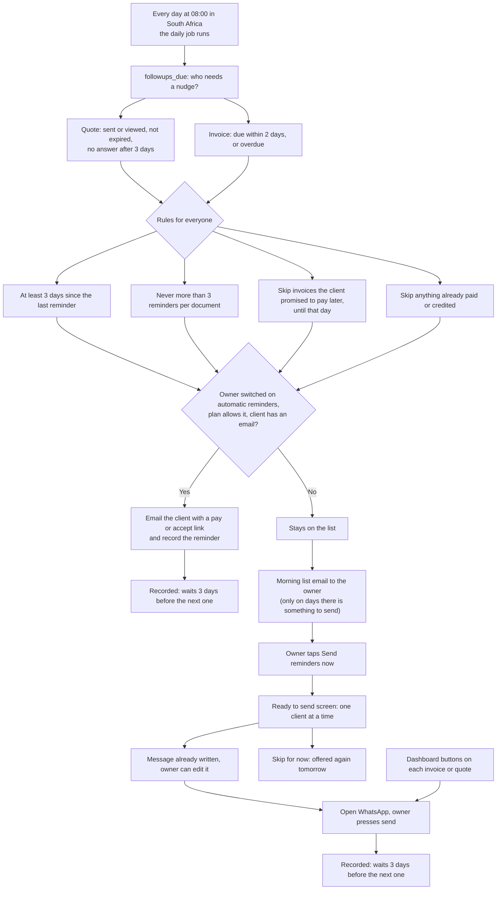

# How reminders work

Yebo chases the money and the unanswered quotes for you, in two ways that work together:

1. **Automatic email to the client.** For owners who switched on "Send reminders for me automatically".
2. **A morning list for the owner, with one-tap WhatsApp.** For everything the automatic email does not cover. The owner presses send in their own WhatsApp, so nothing is automated against WhatsApp's rules and no number can be banned.

## The daily flow

## What the owner sees

| Where | What happens |
| --- | --- |
| **Morning email** (about 8am) | "3 reminders ready for you": client, number, amount and how long it has waited. One button opens the list. Only sent when there is something to send. |
| **`/app/reminders`** | One card per client: the reason (overdue, due soon, quote follow-up), the written message, **Open WhatsApp** and **Skip for now**. A progress bar shows how many are left. |
| **After tapping Open WhatsApp** | WhatsApp opens on the client's chat with the message filled in. The owner reads it and presses send. Back in Yebo, the next card is ready. |
| **Switch** | At the bottom of the page: "Email me this list every morning" On or Off. |
| **Dashboard and each document** | The same one-tap reminder buttons are still there for anything the owner wants to send at other times. |

## What the client sees

The client gets a friendly message from the business, either an email with a button or a WhatsApp message, with the link to their quote or invoice. The link always shows the current state, so a client who has paid in the meantime sees a receipt, not a demand.

## Rules that protect the relationship

- **Never nagging.** At least 3 days apart, and at most 3 reminders per document.
- **Promises are respected.** If a client picks a payment date on the invoice page, reminders pause until that day.
- **Part payments and credit notes count.** The message always asks for what is still owed, not the original total.
- **No double reminders.** The morning list is built after the automatic emails, so a client who was just emailed is not on the list.
- **The owner is in control on WhatsApp.** Yebo only prepares the message. Nothing is sent without the owner pressing send.

## Where it lives in the code

| Part | File |
| --- | --- |
| Who is due (rules) | `followups_due()` in `supabase/migrations/0002_followups.sql` |
| Daily job (client emails, then morning list) | `src/app/api/cron/reminders/route.ts` |
| Finding and preparing the reminders | `src/lib/reminders-load.ts` |
| Message wording, sorting, short descriptions | `src/lib/reminder-queue.ts` |
| Morning email to the owner | `src/lib/morning-list.ts` |
| The "Ready to send" screen | `src/app/app/reminders/` |
| The On/Off setting | `businesses.morning_list` (`0024_morning_list.sql`) |
| Recording a reminder (starts the 3 day wait) | `recordReminderSent` in `src/app/app/documents/actions.ts` |
